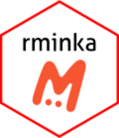

<!-- README.md is generated from README.Rmd. Please edit that file -->

```{r, include = FALSE}
knitr::opts_chunk$set(
  collapse = TRUE,
  comment = "#>",
  fig.path = "man/figures/README-",
  out.width = "100%"
)
```

# rminka <a href="https://devminka.github.io/rminka/"></a>

<!-- badges: start -->
[](https://github.com/devminka/rminka/actions/workflows/R-CMD-check.yaml)
[](https://app.codecov.io/gh/devMinka/rminka)
[](https://lifecycle.r-lib.org/articles/stages.html#stable)
[](https://github.com/devminka/rminka/commits/master)
[](https://github.com/devminka/rminka/releases)
[](https://github.com/devminka/rminka/graphs/contributors)
[](https://www.gnu.org/licenses/gpl-3.0)
[](https://github.com/devminka/rminka/blob/master/inst/CODE_OF_CONDUCT.md)
[](https://doi.org/10.5281/zenodo.21625825)
<!-- badges: end -->


## Usage

Minka is a citizen science platform created by the research group [EMBIMOS](https://www.icm.csic.es/en/research-group/embimos) of the [Institut de Cienciès del Mar (ICM-CSIC)](https://icm.csic.es/en). The platform is open for all users to create their projects, collaborate on others, help the community with identifications or simply upload observations that will be validated with the help of the community and that can be used, in the future, to contribute openly to science and the improvement of the environment.
<br>
The link to access Minka's website is [https://minka-sdg.org/](https://minka-sdg.org/)

The goals of the `rminka`  package are:

1. Directly access the data stored in the Minka platform  to be able to process them with R through the API.

1. Treat the data to be able to use them directly with other packages such as `vegan`, `dismo`, `labdsv` or others.


## Overview

`rminka` is a toolkit for interacting with the [Minka API](https://api.minka-sdg.org/v1/docs/), providing a consistent set of functions to help you query and retrieve biodiversity data. The package's functions are grouped by the type of data they return:

**a) User Queries:** Functions to find users and their contributed observations.

*   `mnk_user_byname()`: Finds a user's ID (`user_id`) from an approximate login name.
*   `mnk_user_info()`: Retrieves detailed information for a user by ID.
*   `mnk_user_proj()`: Finds the projects to which a user has subscribed.
*   `mnk_user_obs()`: Retrieves a user's observations for a given year, optionally filtered by month or day.


**b) Project Queries:** A set of complementary functions to find projects and their associated observations.

*   `mnk_proj_byname()`: Finds a project's ID (`project_id`) using an approximate project name.
*   `mnk_proj_info()`: Retrieves detailed information for a project by ID or slug.
*   `mnk_proj_user()`: Retrieves users subscribed to a project, along with their metadata.
*   `mnk_proj_obs()`: Fetches observations for a project in a given year, optionally filtered by month or day.

**c) Place Queries:** Functions to find places and retrieve their spatial data.

*   `mnk_place_byname()`: Finds a place's ID (`place_id`) using an approximate place name.
*   `mnk_place_sf()`: Returns a place's `sf` geometry, ready for use with packages such as `ggplot2` or `leaflet`.
*   `mnk_place_obs()`: Retrieves observations for a place in a given year, optionally filtered by month or day.


**d) Observation Queries:** A variety of functions to fetch observation data 
based on different parameters.

*   `mnk_obs_id()`: Retrieves a single observation's complete record by ID.
*   `mnk_obs()`: Fetches observations using various filters, including year, month, or day.
*   `mnk_obs_byday()`: Retrieves observations within a specified date range.
*   `mnk_obs_update()`: Downloads observations updated on or after a specified date.

**e) Auxiliary functions:**  A set of functions with different utilities that complement Minka's observational data and help in processing them when used in 
other R packages (`vegan`, `dismo`, `labdsv` or others).

*   `export_mnk_qgis()`: Exports one or more `sf` layers to a GeoPackage (`.gpkg`) for use in QGIS. It uses EPSG:4326 (WGS 84) by default and can transform layers to another CRS.
*   `mnk_obs_sf()`: Converts observation data to an `sf` point layer and lets you select additional attributes. The output uses EPSG:4326 (WGS 84) by default, with an option to transform it to another CRS.
*   `get_wrm_tax()`: Retrieves taxonomic information and habitat flags from [WoRMS](https://www.marinespecies.org/) for a scientific name.
*   `shrt_name()`: Abbreviates scientific names by taking the first three letters of each word and separating them with periods.

These functions are designed to be used together. For queries that span multiple years, you can easily loop through the years of interest, run the appropriate function, and then combine the resulting tibbles with `dplyr::bind_rows()`.


## Installation

You can install the development version of rminka from [GitHub](https://github.com/) with:

``` r
# install.packages("pak")
pak::pak("devminka/rminka")
```


## Using rminka

If you are new to `rminka`, start with the package website or introductory vignette.

1. Visit the [rminka website](https://devminka.github.io/rminka/) for package documentation.

1. Read the [introduction to rminka](https://devminka.github.io/rminka/articles/introduction-to-rminka.html) to get started.


## Getting help

There are two main places to get help with `rminka`:

1.  The [RStudio community][community] is a friendly place to ask any
    questions about R.

1.  [Stack Overflow][so] is a great source of answers to common R
    questions. It is also a great place to get help, once you have
    created a reproducible example that illustrates your problem.

[community]: https://forum.posit.co/
[so]: https://stackoverflow.com/

If you encounter a clear bug, please file an issue with a minimal reproducible example on [GitHub](https://github.com/devminka/rminka/issues). 

## Code of Conduct

Please note that the rminka project is released with a [Contributor Code of Conduct](https://contributor-covenant.org/version/2/1/CODE_OF_CONDUCT.html). By contributing to this project, you agree to abide by its terms.

## Contributing

Contributions are welcome! Please see [CONTRIBUTING.md](https://github.com/devminka/rminka/blob/master/inst/CONTRIBUTING.md) for guidelines.

To contribute:

1. Fork the repo and create your branch from `master`.
2. If you've added code, add tests.
3. Ensure the test suite passes: `devtools::test()`.
4. Make sure `R CMD check` is clean: `devtools::check()`.
5. Submit a pull request.

For bugs or feature requests, please file an issue first to discuss what you would like to change.
